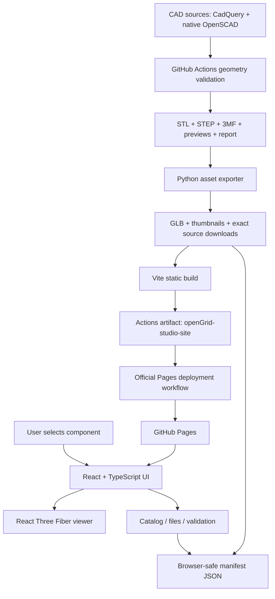

# openGrid Studio: architecture and release process

## Goals

An accessible static CAD browser, interactive Three.js viewer, genuine model downloads, structured provenance, and transparent validation state. Build on the existing CAD library and engineering skills. GitHub Pages can display CAD, but it cannot run OpenSCAD, CadQuery or paid Fusion sessions inside a static web app.

## Source and publication

The studio is located in `web/` to keep the existing `cad/` pipeline unchanged. `scripts/build_site_assets.py` reads the **validated** CAD manifest, checks actual mesh health, exports GLBs for the browser and copies exact originals, while preserving the original engineering statuses. `scripts/check_site.py` verifies that the site contains eight models and that downloadable source paths are real.

The viewer is a consumer of exact, published CAD meshes. It never invents native snap geometry or makes unsupported compatibility claims. Rendering coordinates remain in the same millimetre geometry units; labels use inches.

## Build and deployment

1. CAD workflow builds eight models and executes its existing tests.
2. Python asset conversion produces site catalog, GLBs, thumbnails and files.
3. Vite compiles the responsive React application; site artifacts are uploaded.
4. If Pages is enabled and the CAD workflow succeeds, a separate official Pages workflow deploys the site. Users can also trigger the deploy workflow manually after enabling Pages.

Official Pages setup: Settings → Pages → Build and deployment → **GitHub Actions**.

**Why GitHub Actions source instead of `gh-pages` branch:** GitHub documents that commits pushed to a Pages source branch by the default `GITHUB_TOKEN` do not trigger a Pages build. The official `actions/deploy-pages` API provides repeatable deployment after each successful main-branch build.

## User flows

- Browse, search and filter eight designs by type, select to inspect, and navigate directly to a design via `?part=`.
- Rotate, zoom/pinch, pan, reset, change camera orientation, auto-rotate and toggle the grid and wireframe.
- Review actual mesh bounding-box dimensions, engineering gates, materials and source provenance.
- Download STEP/STL/3MF as available, or GLB for generic 3D viewing.
- Open Customize on the cable hook and adjust safe draft parameters, download a self-contained JSON build request, then run the GitHub CAD workflow with those values. The viewer remains the last CAD-generated shape, explicitly labeled. There is no secret browser token or fictitious real-time CAD engine.
- Use a mobile-specific Library and Details sheet, accessible keyboard controls, responsive toolbar, theme toggle, loading/error states, and reduced-motion support.

## User approval and safety

No operation controls a physical printer. No paid backend or Fusion MCP is invoked. Custom parameters use verified constraints, but remain draft until a new CAD build completes. Publishing model files through public GitHub Pages makes those files publicly accessible.

## Acceptance tests

- Existing Python tests pass, including new source asset export smoke tests.
- All 8 models have GLB meshes, matching preflight evidence, PNG previews, and exact original files.
- Production Vite/TypeScript build passes with no type errors.
- Static site base path `/opengrid-cad-library/` resolves.
- Actual GitHub Pages publication must be confirmed only when its deployment workflow reports success.
- Mobile and desktop browser tests should verify selection, file download links, viewer interaction, and clear draft-generation messaging.
